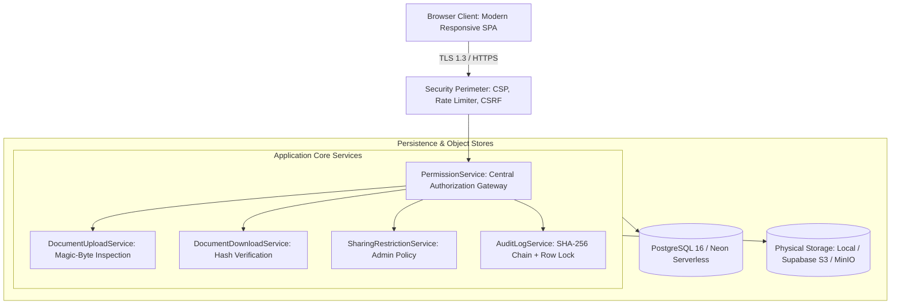

# TrustVault – Secure Enterprise Document Management & Sharing System

[](https://github.com/mattupallipavani/TrustVault)
[](https://openjdk.org/projects/jdk/21/)
[](https://spring.io/projects/spring-boot)
[](https://www.postgresql.org/)
[](docs/SECURITY_DOCUMENTATION.md)
[](LICENSE)

> **TrustVault is an enterprise zero-trust document vault where the server evaluates authorization on every single request, permission revocations execute with zero delay, and all security events are committed to a tamper-evident, SHA-256 chained audit ledger.**

---

## 📑 Complete Documentation Suite

Comprehensive technical and operational documentation is available in the [`docs/`](docs/) directory:

| Document | Purpose & Key Topics |
| :--- | :--- |
| 📘 [**Complete Project Documentation**](docs/PROJECT_DOCUMENTATION.md) | Exhaustive 22-section master documentation covering introduction, objectives, DFDs, ERDs, testing, and compliance. |
| 🏛️ [**System Architecture Guide**](docs/SYSTEM_ARCHITECTURE.md) | Component architecture, Layered Design, DFD Level 0/1, Use Cases, and Storage Abstraction Model. |
| 🗄️ [**Database Design & Schema**](docs/DATABASE_DESIGN.md) | PostgreSQL schema, Entity-Relationship (ER) diagram, table constraints, indexes, and Flyway migration timeline. |
| 🔌 [**REST API Documentation**](docs/API_DOCUMENTATION.md) | Endpoints, HTTP methods, request/response JSON schemas, CSRF protection, and error codes. |
| 🛡️ [**Security & Cryptographic Specs**](docs/SECURITY_DOCUMENTATION.md) | Separation of duties, payload blindness, SHA-256 hash chaining, magic-byte inspection, and rate limiting. |
| 🧪 [**Testing Documentation**](docs/TESTING_DOCUMENTATION.md) | Multi-tiered verification matrix (95 automated tests), unit, integration, ArchUnit, and manual test cases. |
| 📖 [**User Manual & Role Workflows**](docs/USER_MANUAL.md) | Step-by-step role guides for Administrators, Document Owners, and Viewers. |
| 💻 [**Local Installation Guide**](docs/INSTALLATION_GUIDE.md) | Step-by-step developer setup using Docker Compose, PostgreSQL, Redis, and MinIO. |
| 🚀 [**Cloud Deployment Guide**](docs/DEPLOYMENT_GUIDE.md) | Production cloud deployment guide for Render Web Services and Neon PostgreSQL on a ₹0 budget. |

---

## 🏛️ System Architecture



---

## 🚀 Key Capabilities & Architectural Highlights

1. **Centralized Authorization Choke Point**:
   All read, write, share, and download requests route strictly through `PermissionService.java`. Document binary streams cannot be retrieved by ID alone without passing real-time permission evaluation.
2. **Cryptographic Payload Blindness (Separation of Duties)**:
   System Administrators possess broad oversight over user accounts, audit ledgers, and sharing policies, but are **cryptographically barred from reading or downloading confidential document bytes** (`403 Forbidden`).
3. **Immediate Zero-Delay Access Revocation**:
   Permissions are never cached in bearer tokens or client storage. When an Owner or Administrator revokes access, the very next HTTP request from that user is immediately refused.
4. **Administrative Sharing Restrictions**:
   Administrators can block specific users (including document owners) from sharing sensitive files with third parties while preserving their direct ability to view or edit the file.
5. **Tamper-Evident SHA-256 Hash Chained Ledger**:
   Every security event is appended to a cryptographic hash chain anchored by database row locks. Administrators can execute on-demand sweeps verifying ledger integrity from Genesis to Head.
6. **Deep Content & Archive Validation**:
   Files are validated by inspecting magic-byte headers (PDF, PNG, JPEG, DOCX, TXT), preventing file extension spoofing, and checking DOCX archives against decompression-bomb (ZIP-bomb) attacks.
7. **Storage Abstraction & Path Traversal Immunity**:
   Raw binaries are stored under randomized UUID v4 keys, completely decoupling user-supplied filenames from the filesystem or object bucket.

---

## 👥 Role-Based Permission Matrix

| Capability | Administrator (`ADMIN`) | Document Owner (`OWNER`) | Document Viewer (`VIEWER`) |
| :--- | :---: | :---: | :---: |
| **Inspect Vault Metadata** | ✅ All Documents | ✅ Owned & Shared Files | ✅ Shared Files Only |
| **Download Document Content** | ❌ **BLOCKED (Zero-Trust)** | ✅ Owned & Shared Files | ✅ Shared Files Only |
| **Upload & Hash Documents** | ❌ Blocked | ✅ Permitted (Max 10 MB) | ❌ Blocked |
| **Share Documents (`READ` / `EDIT`)** | ✅ Full Authority | ✅ Permitted (Unless Restricted) | ❌ Blocked |
| **Apply / Lift Sharing Restrictions** | ✅ Full Authority | ❌ Blocked | ❌ Blocked |
| **Remove People from Access Lists** | ✅ Full Authority | ✅ Owned Documents | ❌ Blocked |
| **Inspect & Verify Audit Ledger** | ✅ Full Authority | ❌ Blocked | ❌ Blocked |
| **User Management & Password Reset** | ✅ Full Authority | ❌ Blocked | ❌ Blocked |

---

## 📸 User Interface & Dashboard Experience

TrustVault features a responsive, enterprise-grade Single Page Application (SPA) designed with a clean navy-blue, white, and light-blue palette, Inter typography, and real-time KPI metrics.

### 1. Enterprise Authentication Shell
- Split layout highlighting cryptographic architecture on the left and a minimalist sign-in / registration form on the right.
- Password reveal toggle, anti-enumeration password reset requests, and zero demo credentials exposed on the interface.

### 2. Workspace Dashboards
- **Role-Tailored Hero Banner**: Dynamically adapts greeting, context, and security status to the active user role.
- **Real-Time KPI Metrics**: Displays live counters for Accessible Documents, Owned Files, Collaboration Grants, and Vault Volume in bytes.
- **Documents Vault Table**: Features sticky headers, status badges (`OWNER`, `ADMIN`, `EDIT`, `READ`), file size, upload dates, and quick action buttons.

### 3. Access Management & Restrictions Modal
- **Active Access Grants**: View all collaborators and remove access with one click.
- **Grant Access**: Add named users with explicit `READ` or `EDIT` privileges.
- **Administrative Sharing Restrictions**: Dedicated section for administrators to restrict users from sharing specific documents.

---

## 🛠️ Technology Stack

| Tier | Technologies |
| :--- | :--- |
| **Frontend** | HTML5 Semantic SPA, Modern CSS3 (Variables, Flexbox/Grid), Vanilla ES6 JavaScript, Google Fonts (Inter, JetBrains Mono) |
| **Backend Core** | Java 21 LTS, Spring Boot 4.1.2 (`spring-boot-starter-web`, `spring-boot-starter-validation`, `spring-boot-starter-actuator`) |
| **Security & Auth** | Spring Security 7, BCrypt (strength 12), Cookie-based CSRF (`CookieCsrfTokenRepository`), Session Fixation Migration |
| **Persistence** | Spring Data JPA, Hibernate 7, Flyway Database Migrations (`V1` to `V4`), PostgreSQL 16 / Neon Serverless |
| **Testing** | JUnit 5, Mockito, Spring Boot Test, MockMvc, TNG ArchUnit (Architecture Rules), H2 In-Memory Database |
| **Container & CI/CD** | Docker Multi-Stage Build (Temurin 21 JDK/JRE), Docker Compose, Render Web Service, GitHub Auto-Deploy |

---

## ⚡ Quick Start (Local Setup)

### Prerequisites
- **Java 21 LTS** installed (`java -version`).
- **Docker & Docker Compose** installed (`docker compose version`).

### Step-by-Step Execution
```bash
# 1. Clone the repository
git clone https://github.com/mattupallipavani/TrustVault.git
cd TrustVault

# 2. Copy the template environment configuration
cp .env.example .env

# 3. Start PostgreSQL, Redis, and MinIO in Docker
docker compose -f docker-compose.yml -f docker-compose.dev.yml up -d postgres redis minio

# 4. Run the automated test suite
./mvnw clean test

# 5. Launch the TrustVault Spring Boot application
./mvnw spring-boot:run
```

Access the application in your browser at:
👉 **`http://localhost:8080`**

### Default Seeded Demonstration Accounts
Seeded automatically on an empty database (configured via `DEMO_PASSWORD` in `.env`):
- **Administrator**: `admin@trustvault.local` / `TrustVault#2026`
- **Document Owner**: `owner@trustvault.local` / `TrustVault#2026`
- **Document Viewer**: `viewer@trustvault.local` / `TrustVault#2026`

---

## 🧪 Automated Testing & Verification Suite

TrustVault includes **95 automated tests** across all architectural layers:

```bash
# Run all unit, integration, and architecture tests
./mvnw test
```

- **`AuthorizationIntegrationTest`**: 22 HTTP integration tests verifying CSRF enforcement, role boundaries, access refusals, and immediate revocation.
- **`PermissionServiceTest`**: 11 unit tests verifying access matrices, ownership policies, and sharing restrictions.
- **`FileValidationServiceTest`**: 15 tests covering PDF, PNG, JPG, DOCX magic bytes, ZIP-bomb detection, and invalid formats.
- **`AuditLogIntegrityServiceTest`**: 5 tests verifying SHA-256 chain calculation, Genesis anchoring, and tamper detection.
- **`StorageIntegrityServiceTest`**: 7 tests covering storage sweeps, hash mismatches, and size verifications.
- **`ArchitectureTest`**: 9 ArchUnit rules enforcing strict layered package structure and no cyclic dependencies.

---

## 📄 License

This project is licensed under the MIT License — see the [LICENSE](LICENSE) file for details.
