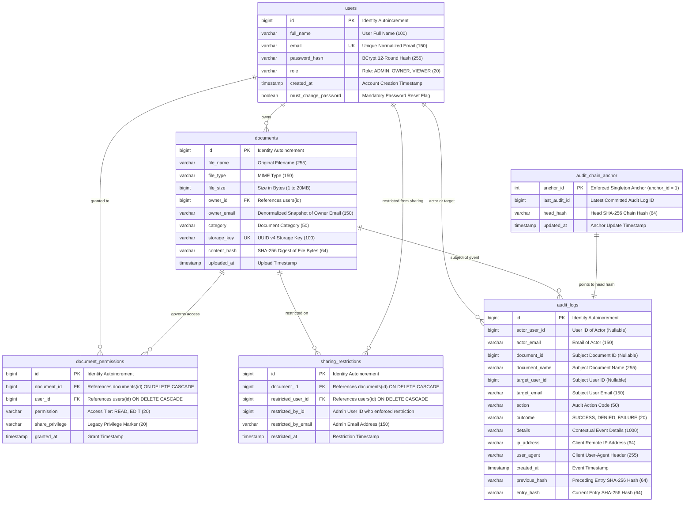

# TrustVault Database Design & Schema Specification

## 1. Schema Overview

TrustVault's database layer is built on PostgreSQL (compatible with H2 in PostgreSQL mode for in-memory integration testing) and managed via declarative Flyway migrations (`V1` through `V4`).

The relational model enforces:
- **Strict Data Integrity**: Foreign key constraints with explicit cascade and restrict behaviors prevent orphaned documents or permission leaks.
- **Atomic Concurrency for Ledger Chaining**: The `audit_chain_anchor` table uses a dedicated single-row lock (`anchor_id = 1`) to guarantee serialization of audit events without blocking general read operations.
- **Defense Against SQL Injection**: All queries utilize JPA criteria, named parameters, and explicit type casts (`cast(:documentId as Long)`).
- **Index Optimization**: Composite and single-column b-tree indexes accelerate user lookups, document ownership filtering, and audit log analysis.

---

## 2. Entity-Relationship (ER) Diagram

---

## 3. Table Schema Specifications

### 3.1 `users` Table
Stores enterprise account credentials, role designations, and security state.

| Column | Data Type | Nullable | Constraints & Defaults | Description |
| :--- | :--- | :--- | :--- | :--- |
| `id` | `BIGINT` | `NO` | `PRIMARY KEY GENERATED BY DEFAULT AS IDENTITY` | System primary key |
| `full_name` | `VARCHAR(100)` | `NO` | None | Full display name of the user |
| `email` | `VARCHAR(150)` | `NO` | `CONSTRAINT uk_users_email UNIQUE` | Unique email (normalized case-insensitive) |
| `password_hash` | `VARCHAR(255)` | `NO` | None | BCrypt hash (strength 12) |
| `role` | `VARCHAR(20)` | `NO` | `CHECK (role IN ('ADMIN', 'OWNER', 'VIEWER'))` | Role authorization level |
| `created_at` | `TIMESTAMP(6)` | `NO` | `DEFAULT CURRENT_TIMESTAMP` | Account creation timestamp |
| `must_change_password`| `BOOLEAN` | `NO` | `DEFAULT FALSE` | True if temp password was issued |

**Indexes**:
- `uk_users_email`: Unique B-Tree index on `email`.

---

### 3.2 `documents` Table
Stores metadata for all vaulted documents. Document payloads are strictly decoupled.

| Column | Data Type | Nullable | Constraints & Defaults | Description |
| :--- | :--- | :--- | :--- | :--- |
| `id` | `BIGINT` | `NO` | `PRIMARY KEY GENERATED BY DEFAULT AS IDENTITY` | Unique document ID |
| `file_name` | `VARCHAR(255)` | `NO` | None | Original uploaded filename |
| `file_type` | `VARCHAR(150)` | `NO` | None | MIME type detected via magic bytes |
| `file_size` | `BIGINT` | `NO` | `CHECK (file_size > 0 AND file_size <= 20971520)` | Size in bytes (max 20 MB) |
| `owner_id` | `BIGINT` | `NO` | `FOREIGN KEY (owner_id) REFERENCES users(id) ON DELETE RESTRICT` | Account that uploaded/owns document |
| `owner_email` | `VARCHAR(150)` | `NO` | None | Denormalized snapshot of owner email |
| `category` | `VARCHAR(50)` | `NO` | None | Security classification (Legal, HR, etc.) |
| `storage_key` | `VARCHAR(100)` | `NO` | `CONSTRAINT uk_documents_storage_key UNIQUE` | UUID v4 object store key |
| `content_hash`| `VARCHAR(64)` | `YES` | None | SHA-256 hash of raw file bytes |
| `uploaded_at` | `TIMESTAMP(6)` | `NO` | `DEFAULT CURRENT_TIMESTAMP` | Upload timestamp |

**Indexes**:
- `uk_documents_storage_key`: Unique B-Tree index on `storage_key`.
- `idx_documents_owner`: B-Tree index on `owner_id`.
- `idx_documents_uploaded_at`: B-Tree index on `uploaded_at`.
- `idx_documents_category`: B-Tree index on `category`.

---

### 3.3 `document_permissions` Table
Maintains explicit read/edit grants given by Owners or Administrators to other users.

| Column | Data Type | Nullable | Constraints & Defaults | Description |
| :--- | :--- | :--- | :--- | :--- |
| `id` | `BIGINT` | `NO` | `PRIMARY KEY GENERATED BY DEFAULT AS IDENTITY` | Permission grant ID |
| `document_id` | `BIGINT` | `NO` | `FOREIGN KEY REFERENCES documents(id) ON DELETE CASCADE` | Associated document |
| `user_id` | `BIGINT` | `NO` | `FOREIGN KEY REFERENCES users(id) ON DELETE CASCADE` | Granted user account |
| `permission` | `VARCHAR(20)` | `NO` | `CHECK (permission IN ('READ', 'EDIT'))` | Access level |
| `share_privilege`| `VARCHAR(20)`| `NO` | `DEFAULT ''` | Legacy share flag |
| `granted_at` | `TIMESTAMP(6)` | `NO` | `DEFAULT CURRENT_TIMESTAMP` | Grant timestamp |

**Constraints & Indexes**:
- `uk_permission_document_user`: Unique constraint on `(document_id, user_id)`.
- `idx_permission_user`: B-Tree index on `user_id`.

---

### 3.4 `sharing_restrictions` Table
Allows Administrators to block a specific user (Owner, Viewer, or Admin) from sharing a document without altering their direct read/edit privileges.

| Column | Data Type | Nullable | Constraints & Defaults | Description |
| :--- | :--- | :--- | :--- | :--- |
| `id` | `BIGINT` | `NO` | `PRIMARY KEY GENERATED BY DEFAULT AS IDENTITY` | Restriction ID |
| `document_id` | `BIGINT` | `NO` | `FOREIGN KEY REFERENCES documents(id) ON DELETE CASCADE` | Document under restriction |
| `restricted_user_id` | `BIGINT` | `NO` | `FOREIGN KEY REFERENCES users(id) ON DELETE CASCADE` | User barred from sharing |
| `restricted_by_id` | `BIGINT` | `NO` | None | Administrator user ID |
| `restricted_by_email` | `VARCHAR(150)`| `NO` | None | Administrator email snapshot |
| `restricted_at` | `TIMESTAMP(6)`| `NO` | `DEFAULT CURRENT_TIMESTAMP` | Timestamp restriction was applied |

**Constraints & Indexes**:
- `uk_sharing_restriction_document_user`: Unique constraint on `(document_id, restricted_user_id)`.
- `idx_sharing_restriction_document`: B-Tree index on `document_id`.
- `idx_sharing_restriction_user`: B-Tree index on `restricted_user_id`.

---

### 3.5 `audit_logs` Table
Append-only cryptographic audit record storing tamper-evident SHA-256 chained events.

| Column | Data Type | Nullable | Constraints & Defaults | Description |
| :--- | :--- | :--- | :--- | :--- |
| `id` | `BIGINT` | `NO` | `PRIMARY KEY GENERATED BY DEFAULT AS IDENTITY` | Sequential event ID |
| `actor_user_id`| `BIGINT` | `YES` | None | Actor account ID |
| `actor_email` | `VARCHAR(150)` | `YES` | None | Actor email address |
| `document_id` | `BIGINT` | `YES` | None | Document ID involved in event |
| `document_name`| `VARCHAR(255)`| `YES` | None | Snapshot of document name |
| `target_user_id`| `BIGINT` | `YES` | None | Target user ID affected |
| `target_email`| `VARCHAR(150)` | `YES` | None | Target user email |
| `action` | `VARCHAR(50)` | `NO` | None | Security action code |
| `outcome` | `VARCHAR(20)` | `NO` | `CHECK (outcome IN ('SUCCESS', 'DENIED', 'FAILURE'))`| Action outcome |
| `details` | `VARCHAR(1000)`| `YES` | None | Event description / refusal reason |
| `ip_address` | `VARCHAR(64)` | `YES` | None | Client remote IP address |
| `user_agent` | `VARCHAR(255)` | `YES` | None | Client User-Agent header |
| `created_at` | `TIMESTAMP(6)` | `NO` | None | Event generation timestamp |
| `previous_hash`| `VARCHAR(64)` | `NO` | None | Preceding entry SHA-256 hash |
| `entry_hash` | `VARCHAR(64)` | `NO` | None | Computed SHA-256 entry hash |

**Indexes**:
- `idx_audit_document`: B-Tree index on `document_id`.
- `idx_audit_actor`: B-Tree index on `actor_user_id`.
- `idx_audit_created_at`: B-Tree index on `created_at`.

---

### 3.6 `audit_chain_anchor` Table
Maintains the latest cryptographic head hash of the ledger. Guarantees linear consistency across concurrent operations.

| Column | Data Type | Nullable | Constraints & Defaults | Description |
| :--- | :--- | :--- | :--- | :--- |
| `anchor_id` | `INT` | `NO` | `PRIMARY KEY, DEFAULT 1, CHECK (anchor_id = 1)` | Enforces single-row singleton pattern |
| `last_audit_id`| `BIGINT` | `YES` | None | ID of the most recent audit log entry |
| `head_hash` | `VARCHAR(64)` | `NO` | None | Current SHA-256 tip of the chain |
| `updated_at` | `TIMESTAMP(6)` | `NO` | `DEFAULT CURRENT_TIMESTAMP` | Last anchor update time |

---

## 4. Flyway Migrations Timeline

TrustVault uses standard, sequential Flyway migrations located in `src/main/resources/db/migration/`:

1. **`V1__initial_schema.sql`**:
   - Baseline creation of `users`, `documents`, `document_permissions`, `audit_chain_anchor`, and `audit_logs`.
   - Populates initial genesis block in `audit_chain_anchor` (`head_hash = 'GENESIS'`).
2. **`V2__reconcile_schema_drift.sql`**:
   - Reconciles type lengths and ensures constraint naming uniformity across PostgreSQL distributions.
3. **`V3__session_and_password_policy.sql`**:
   - Adds `must_change_password` boolean column to `users` for administrative temporary credential management.
4. **`V4__sharing_restrictions.sql`**:
   - Introduces the `sharing_restrictions` table with unique constraint and foreign keys on `documents` and `users`.
