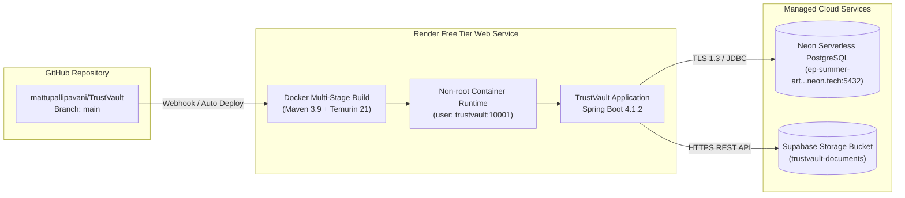

# TrustVault Cloud Deployment Guide

## 1. Production Architecture Overview

TrustVault is optimized for cost-effective, high-reliability cloud deployment. The reference architecture utilizes a **Strictly ₹0 Budget (Zero-Cost / No Credit Card Required)** stack:

- **Compute & Web Hosting**: [Render](https://render.com) Free Web Service (Docker runtime, dynamic port binding, automated GitHub deployment).
- **Relational Database**: [Neon](https://neon.tech) Serverless PostgreSQL (AWS `us-east-2`, SSL required, pooling support).
- **Physical Document Storage**:
  - *Option 1*: Local container storage (`STORAGE_TYPE=local` in `/app/trustvault-storage`). Note: Render's free tier has an ephemeral disk that resets on container restart.
  - *Option 2 (Permanent)*: [Supabase](https://supabase.com) Free Storage (S3-compatible, persistent cloud bucket via standard HTTPS REST API).



---

## 2. Docker Multi-Stage Build Pipeline

TrustVault uses a secure, hardened multi-stage `Dockerfile`:

### Stage 1: Dependency Resolution & Packaging (`build`)
- Base image: `eclipse-temurin:21-jdk-alpine`.
- Copies `pom.xml` and runs `dependency:resolve` to cache third-party libraries in Docker layers.
- Sets memory boundaries: `MAVEN_OPTS="-Xmx512m -XX:+UseSerialGC"` to prevent OOM errors on free tier build nodes.
- Compiles source code and packages executable JAR (`mvn package -DskipTests`).

### Stage 2: Hardened Production Runtime (`stage-1`)
- Base image: `eclipse-temurin:21-jre-alpine`.
- Installs `curl` for container health checks.
- Creates an unprivileged non-root user and group: `trustvault:trustvault` (UID/GID `10001`).
- Pre-creates `/app/trustvault-storage` and `/data` with ownership `10001:10001`.
- Sets standard `/tmp` directory (`-Djava.io.tmpdir=/tmp`) for Tomcat temporary multipart uploads.
- Exposes port `8080` (or binds to Render's dynamic `$PORT`).

---

## 3. Step-by-Step Deployment on Render

### Step 1: Provision Managed Database (Neon PostgreSQL)
1. Sign up at [neon.tech](https://neon.tech) (no credit card required).
2. Create a new PostgreSQL project (e.g. `trustvault-prod`).
3. Note your connection details:
   - Host: `ep-summer-art-beax4drq-pooler.c-9.us-east-2.aws.neon.tech`
   - Database: `neondb`
   - User: `neondb_owner`
   - SSL Mode: `require`

### Step 2: Configure Render Web Service
1. Log in to [render.com](https://render.com).
2. Click **New +** &rarr; **Web Service**.
3. Connect your GitHub repository: `https://github.com/mattupallipavani/TrustVault`.
4. Configure service settings:
   - **Name**: `trustvault`
   - **Region**: Oregon (US West) or Ohio (US East)
   - **Branch**: `main`
   - **Runtime**: `Docker`
   - **Instance Type**: `Free`

### Step 3: Add Environment Variables in Render
Under the **Environment** tab of your Render Web Service, enter the following environment variables:

| Key | Value / Example | Notes |
| :--- | :--- | :--- |
| `DB_URL` | `jdbc:postgresql://your-neon-host:5432/neondb?sslmode=require` | JDBC URL for Neon |
| `DB_USERNAME` | `neondb_owner` | Neon database username |
| `DB_PASSWORD` | `your_neon_secret_password` | Neon database password |
| `STORAGE_TYPE` | `local` (or `supabase`) | Storage provider |
| `STORAGE_LOCATION`| `/app/trustvault-storage` | Local container path |
| `DEMO_PASSWORD` | `TrustVault#2026` | Initial seed password |
| `SESSION_COOKIE_SECURE` | `true` | Enforces HTTPS cookies |
| `DDL_AUTO` | `validate` | Enforces Flyway migrations |
| `MANAGEMENT_HEALTH_REDIS_ENABLED` | `false` | Disables Redis health indicator in standalone mode |

### Step 4: Deploy & Verify
1. Click **Create Web Service**.
2. Render pulls the repository, builds the multi-stage Docker image, runs Flyway database migrations (`V1` through `V4`), and starts the application.
3. Access your live application at `https://trustvault-xxxx.onrender.com`.

---

## 4. Optional: Persistent Cloud Storage with Supabase

If you want files to persist across Render container restarts on a ₹0 budget:

1. Create a free account at [supabase.com](https://supabase.com).
2. Create a private bucket named `trustvault-documents`.
3. In Render, add these environment variables:
   ```dotenv
   STORAGE_TYPE=supabase
   TRUSTVAULT_STORAGE_SUPABASE_URL=https://your-project.supabase.co
   TRUSTVAULT_STORAGE_SUPABASE_SERVICE_KEY=your_supabase_service_role_secret
   TRUSTVAULT_STORAGE_SUPABASE_BUCKET=trustvault-documents
   ```
4. `SupabaseStorageService` will automatically activate and store uploaded files in your Supabase bucket.

---

## 5. Post-Deployment Verification Checklist

- [ ] **Database Connection**: Flyway schema history shows all migrations applied (`V1` to `V4`).
- [ ] **Health Endpoint**: `curl https://your-service.onrender.com/api/health` returns `{"status":"UP"}`.
- [ ] **Admin Verification**: Sign in as `admin@trustvault.local`, open Audit Trail, and click **Verify Chain Integrity**.
- [ ] **Upload Test**: Sign in as `owner@trustvault.local`, upload a test PDF, and verify SHA-256 fingerprinting.
- [ ] **Sharing Test**: Share the document with `viewer@trustvault.local`, log in as Viewer, and verify download.
- [ ] **Restriction Test**: As Admin, apply a sharing restriction on the Owner for that document, and verify the Owner cannot grant access to new users.
