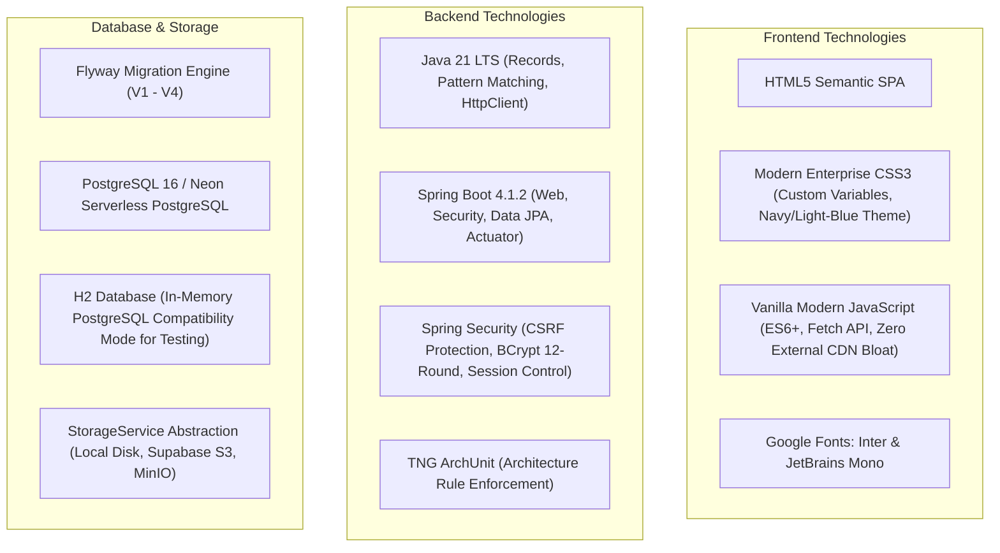
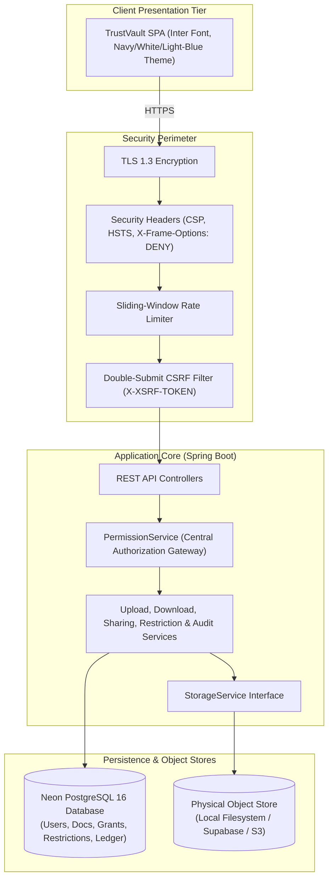
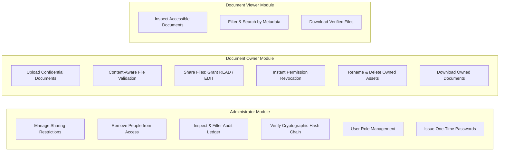
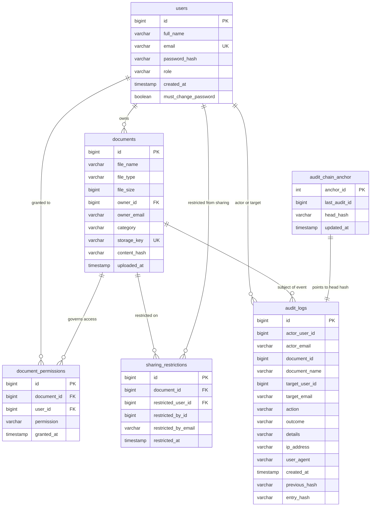
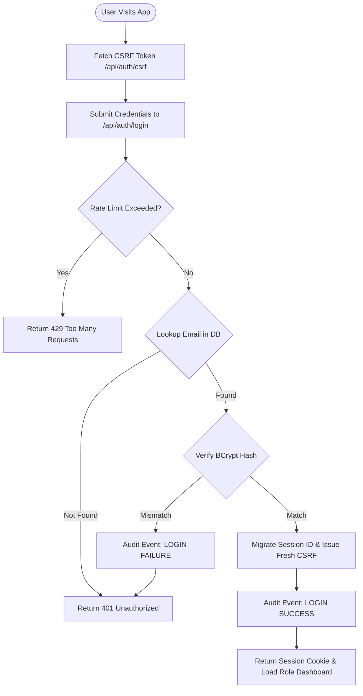
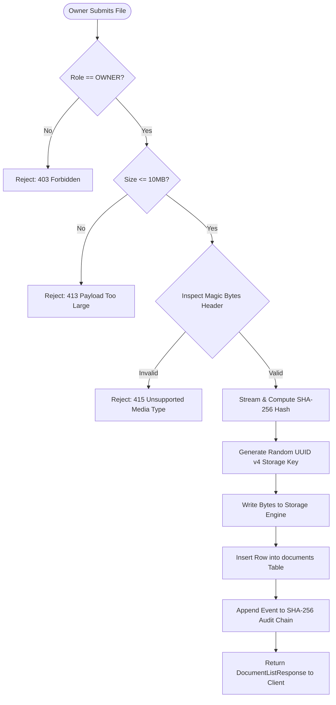
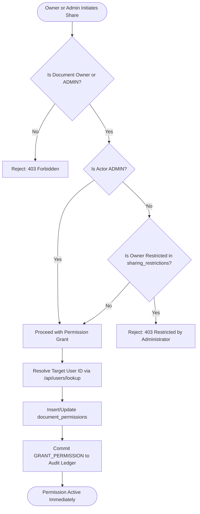

# TrustVault – Secure Document Management and Sharing System
## Comprehensive Project Documentation

---

### Table of Contents
1. [Project Introduction](#1-project-introduction)
2. [Objectives](#2-objectives)
3. [Existing System Analysis](#3-existing-system-analysis)
4. [Proposed System Overview](#4-proposed-system-overview)
5. [Technology Stack](#5-technology-stack)
6. [System Architecture](#6-system-architecture)
7. [Modules Description](#7-modules-description)
8. [Functional Requirements](#8-functional-requirements)
9. [Non-Functional Requirements](#9-non-functional-requirements)
10. [Database Design & Schema](#10-database-design--schema)
11. [API Documentation Summary](#11-api-documentation-summary)
12. [Security Architecture & Implementation](#12-security-architecture--implementation)
13. [System Workflow Diagrams](#13-system-workflow-diagrams)
14. [Installation & Configuration](#14-installation--configuration)
15. [Testing & Verification Suite](#15-testing--verification-suite)
16. [User Manual & Role Workflows](#16-user-manual--role-workflows)
17. [Deployment Guide](#17-deployment-guide)
18. [Advantages & Practical Applications](#18-advantages--practical-applications)
19. [System Limitations](#19-system-limitations)
20. [Future Enhancements](#20-future-enhancements)
21. [Conclusion](#21-conclusion)
22. [References](#22-references)

---

## 1. Project Introduction

### 1.1 Background
In contemporary enterprise environments, sensitive documentation—such as legal contracts, financial filings, proprietary intellectual property, employee human resource records, and medical data—is continually distributed across disparate networks, clouds, and collaborators.

### 1.2 Problem Statement
Traditional Document Management Systems (DMS) and cloud storage providers often rely on perimeter security models and coarse-grained access control lists. This architecture suffers from three critical vulnerabilities:
1. **The Superuser Trap**: System administrators are granted unrestricted access to database tables and underlying filesystem objects, creating catastrophic insider threat exposure and compliance violations (SOC-2, HIPAA, GDPR).
2. **Delayed Access Revocation**: Permissions are frequently cached client-side or in distributed JWT tokens, allowing revoked users to continue reading or downloading sensitive data until token expiry.
3. **Malleable Audit Logs**: Traditional text or database logs can be surreptitiously edited, truncated, or cleared by an attacker who gains root or DBA access, destroying non-repudiation and legal admissibility.

### 1.3 Project Motivation
**TrustVault** is designed from first principles as an **Enterprise Zero-Trust Document Management and Cryptographic Audit System**. It guarantees that the server evaluates every access attempt in real time, bars administrators from viewing confidential document payloads, and binds all administrative and collaborative actions into an append-only, SHA-256 chained tamper-evident ledger.

---

## 2. Objectives

- **Enforce Cryptographic Separation of Duties**: Bar administrative accounts from downloading, reading, or opening document payloads while granting them comprehensive audit and restriction management capabilities.
- **Immediate Zero-Delay Access Revocation**: Ensure permission revocations and sharing restrictions take effect on the very next HTTP packet without caching delays.
- **Provable Audit Immutability**: Implement sequential SHA-256 hash chaining anchored by atomic database row locking to guarantee mathematical tamper detection.
- **Content-Addressable Document Integrity**: Verify uploaded files against deep magic-byte inspection (preventing file extension spoofing and decompression-bomb attacks) and compute SHA-256 digests verified on every download.
- **Enterprise-Grade User Experience**: Provide a modern, responsive Single Page Application (SPA) with role-tailored dashboards for Administrators, Document Owners, and Viewers.

---

## 3. Existing System Analysis

| Characteristic | Traditional Document Management Systems | Security & Operational Risk |
| :--- | :--- | :--- |
| **Administrator Access** | Full read/write access to all files and database rows. | An administrative credential leak exposes 100% of confidential files. |
| **Permission Revocation**| Token-based (JWT) with TTL or polling interval. | Revoked users can continue downloading files for minutes or hours. |
| **Audit Trails** | Plain text files or regular database tables without cryptographic hashing. | Logs can be edited or deleted by attackers or malicious insiders without detection. |
| **File Verification** | Filename extension matching (`.pdf`, `.docx`). | Attackers rename `.exe` or malicious scripts to bypass upload filters. |
| **Sharing Restrictions**| Binary: user can either edit/share everything or nothing. | Owners cannot be restricted from distributing specific sensitive files without taking away their ownership. |

---

## 4. Proposed System Overview

TrustVault introduces an enterprise-grade architecture that resolves these systemic flaws:

1. **Cryptographic Payload Blindness**: Administrators have no route or API to download file bytes. Any attempt results in a `403 Forbidden` response and generates a high-priority security alert in the audit ledger.
2. **Centralized Real-Time Authorization**: All access queries must pass through `PermissionService.java`. The system maintains zero distributed access tokens; permission state is queried fresh on every request.
3. **Tamper-Evident SHA-256 Ledger**: Every login, upload, download, share, revocation, and restriction is chained to the preceding entry's hash. A one-click cryptographic sweep instantly verifies ledger integrity.
4. **Deep File Content Validation**: File inspection reads initial magic bytes and archive headers to prevent malicious upload masquerading and ZIP-bomb attacks.
5. **Administrative Sharing Restrictions**: Administrators can selectively restrict users (including owners) from sharing specific documents while preserving their ability to view and edit.

---

## 5. Technology Stack



### Detailed Component Matrix
- **Server Framework**: Spring Boot 4.1.2 on Java 21 LTS.
- **ORM / Persistence**: Spring Data JPA with Hibernate 7.
- **Database Migrations**: Flyway Database Migration Engine (`db/migration/V1__...` to `V4__...`).
- **Security Engine**: Spring Security with Cookie-based CSRF protection, BCrypt (cost factor 12), and session fixation migration.
- **Client Application**: Single Page Application (SPA) written in pure semantic HTML5, modern CSS3, and standard ES6 JavaScript. Zero third-party JavaScript dependencies or trackers.

---

## 6. System Architecture



The system employs a layered, decoupled architecture ensuring that controllers never directly query storage engines or repositories, and authorization checks are enforced centrally before any service returns file bytes.

---

## 7. Modules Description

TrustVault is organized into three distinct, mutually reinforced functional modules based on user roles:



### 7.1 Administrator Module (`ADMIN`)
- **Document Oversight without Payload Exposure**: Can view all document metadata (filenames, owners, categories, upload timestamps, size) across the vault, but possesses zero access to view or download file bytes.
- **Sharing Restrictions Management**: Can selectively block any user (including document owners) from distributing specific documents to prevent data leakage.
- **Direct User Access Revocation**: Can remove any user grant from a document with one click.
- **Tamper-Evident Audit Ledger**: Can filter audit events by action, actor, and outcome, and trigger on-demand cryptographic verification of the SHA-256 hash chain.
- **User Administration**: Can assign roles (`ADMIN`, `OWNER`, `VIEWER`) and generate secure, one-time temporary passwords for users who cannot authenticate.

### 7.2 Document Owner Module (`OWNER`)
- **Document Upload**: Upload confidential assets (PDF, DOCX, PNG, JPG, TXT up to 10 MB). The server scans magic bytes and calculates a SHA-256 fingerprint.
- **Access Delegation**: Grant explicit `READ` (view & download) or `EDIT` (modify metadata & view) permissions to named enterprise users.
- **Immediate Revocation**: Revoke grants instantly; subsequent download requests are immediately blocked.
- **Lifecycle Control**: Update metadata (category, filename) or permanently delete owned documents and their associated storage objects.

### 7.3 Document Viewer Module (`VIEWER`)
- **Authorized Reading Portal**: Displays only documents explicitly shared with the viewer's account.
- **Search & Filter**: Allows searching accessible documents by keyword, owner email, category, and date.
- **Secure Download**: Downloads verified documents with server-side SHA-256 integrity verification.

---

## 8. Functional Requirements

| Req ID | Module | Description | Enforced By |
| :--- | :--- | :--- | :--- |
| `FR-01` | Auth | Users can register with name, email, and password (&ge;12 chars). | `AuthController.java` |
| `FR-02` | Auth | Users authenticate via session cookies with CSRF token protection. | `SecurityConfig.java` |
| `FR-03` | Auth | Users can request temporary password resets via an anti-enumeration form. | `AuthController.java` |
| `FR-04` | Owner | Owners can upload documents up to 10 MB with security categories. | `DocumentUploadController.java` |
| `FR-05` | Owner | System inspects file magic bytes and rejects spoofed extensions. | `FileValidationService.java` |
| `FR-06` | Owner | Owners can grant `READ` or `EDIT` access to valid user emails. | `PermissionController.java` |
| `FR-07` | Owner | Owners can revoke access grants with zero-delay enforcement. | `PermissionController.java` |
| `FR-08` | Owner | Owners can download, rename, and permanently delete their files. | `DocumentsController.java` |
| `FR-09` | Viewer | Viewers can view and search documents shared with their account. | `DocumentListService.java` |
| `FR-10` | Viewer | Viewers can download authorized documents; unshared files are blocked. | `DocumentDownloadService.java` |
| `FR-11` | Admin | Administrators can view metadata for all documents in the vault. | `DocumentListService.java` |
| `FR-12` | Admin | Administrators are barred from downloading document contents (`403`). | `PermissionService.java` |
| `FR-13` | Admin | Administrators can block any user from sharing a specific document. | `AdminRestrictionController.java` |
| `FR-14` | Admin | Administrators can lift sharing restrictions at any time. | `AdminRestrictionController.java` |
| `FR-15` | Admin | Administrators can remove any person from a document's grant list. | `PermissionController.java` |
| `FR-16` | Admin | Administrators can inspect audit logs and trigger hash chain verification. | `AdminAuditController.java` |
| `FR-17` | Admin | Administrators can change user roles and issue temporary passwords. | `AdminUserController.java` |

---

## 9. Non-Functional Requirements

### 9.1 Security
- **Confidentiality**: Documents stored under randomized UUID v4 keys; zero user data exposed in file paths.
- **Integrity**: Files fingerprinted with SHA-256; audit logs bound in a cryptographic hash chain.
- **Accountability**: Every security event (including refused access attempts) recorded with actor email, IP address, and timestamp.
- **Defense-in-Depth**: Strict Content Security Policy (CSP), frame options (`DENY`), rate limiting, and double-submit CSRF tokens.

### 9.2 Performance & Scalability
- **Streaming Uploads & Downloads**: File transfers use native streaming without loading full binary payloads into JVM heap memory.
- **Optimized Indexing**: Database indexes on `owner_id`, `uploaded_at`, `category`, and `user_id` keep query latency under 10ms for search operations.
- **Asynchronous Health Checks**: Actuator health and storage verification sweeps run asynchronously to avoid impacting user request threads.

### 9.3 Usability & Reliability
- **Responsive Layout**: Adapts cleanly across mobile, tablet, and widescreen desktop monitors.
- **Fail-Closed Design**: Corrupted or ambiguous permission rows in the database result in immediate access denial (`fail-closed`), never access grants.

---

## 10. Database Design & Schema

### 10.1 Entity-Relationship (ER) Diagram



### 10.2 Database Tables Summary
1. **`users`**: Contains system user profiles, role designations, and BCrypt hashes.
2. **`documents`**: Metadata for uploaded assets, containing owner references and SHA-256 fingerprints.
3. **`document_permissions`**: Explicit collaboration grants (`READ` / `EDIT`) per user per document.
4. **`sharing_restrictions`**: Administrative restriction records preventing target users from sharing specific files.
5. **`audit_logs`**: Append-only log recording all system events with previous and entry SHA-256 hashes.
6. **`audit_chain_anchor`**: Singleton table locking the latest cryptographic tip of the ledger.

---

## 11. API Documentation Summary

| Method | Endpoint | Access Role | Description |
| :--- | :--- | :--- | :--- |
| `GET` | `/api/auth/csrf` | Public | Obtain CSRF token for subsequent requests |
| `POST`| `/api/auth/login` | Public | Authenticate with username and password |
| `POST`| `/api/auth/logout` | Authenticated | Terminate session and invalidate cookies |
| `POST`| `/api/auth/register` | Public | Register a new user account |
| `POST`| `/api/auth/forgot-password` | Public | Request temporary password reset |
| `GET` | `/api/users/me` | Authenticated | Retrieve current user profile and role |
| `GET` | `/api/users/lookup?email=...` | Authenticated | Exact-match email lookup for sharing |
| `GET` | `/api/admin/users` | `ADMIN` | List all users and their assigned roles |
| `PATCH`| `/api/admin/users/{userId}/role` | `ADMIN` | Update user role (`ADMIN`, `OWNER`, `VIEWER`) |
| `POST`| `/api/admin/users/{userId}/reset-password` | `ADMIN` | Issue one-time temporary password |
| `GET` | `/api/documents` | Authenticated | List accessible documents for active user |
| `GET` | `/api/documents/search` | Authenticated | Search documents by keyword, owner, or date |
| `POST`| `/api/documents/upload` | `OWNER` | Upload and hash a new confidential file |
| `GET` | `/api/documents/{id}/download` | Owner/Grantee | Download verified file bytes (blocked for Admin) |
| `PUT` | `/api/documents/{id}` | Owner/Editor | Update document filename and category |
| `DELETE`| `/api/documents/{id}` | `OWNER` | Permanently delete document and storage object |
| `GET` | `/api/permissions/{documentId}` | Owner/Admin | List active grants on a document |
| `POST`| `/api/permissions/grant/{documentId}` | Owner/Admin | Grant `READ` or `EDIT` permission to a user |
| `DELETE`| `/api/permissions/revoke/{docId}/{userId}` | Owner/Admin | Revoke user access grant |
| `GET` | `/api/admin/restrictions/{documentId}` | `ADMIN` | List active sharing restrictions on a document |
| `POST`| `/api/admin/restrictions/{docId}/{userId}` | `ADMIN` | Restrict user from sharing a document |
| `DELETE`| `/api/admin/restrictions/{docId}/{userId}` | `ADMIN` | Lift sharing restriction on a user |
| `GET` | `/api/admin/audit` | `ADMIN` | Filter and inspect audit ledger events |
| `GET` | `/api/admin/audit/verify` | `ADMIN` | Verify SHA-256 cryptographic chain integrity |
| `GET` | `/api/health` | Public | Basic system health indicator |

---

## 12. Security Architecture & Implementation

### 12.1 Cryptographic Hash Ledger Pipeline
Every audit entry is sequentially chained:
$$\text{EntryHash}_i = \text{SHA-256}(H_{i-1} \parallel \text{Actor} \parallel \text{Action} \parallel \text{Outcome} \parallel \text{DocID} \parallel T_i \parallel \text{Details})$$
Where $H_0 = \text{"GENESIS"}$. Row-locking on `audit_chain_anchor` guarantees deterministic linear ordering even under high concurrency.

### 12.2 Defense-in-Depth Implementation Matrix
- **Data at Rest**: SHA-256 content hashes, randomized UUID storage keys, BCrypt (strength 12) passwords.
- **Data in Transit**: Mandatory TLS 1.3, HSTS header (`Strict-Transport-Security`).
- **Application Level**: Centralized `PermissionService`, fail-closed exception handling, magic-byte inspection, ZIP-bomb prevention.
- **Session Level**: Single-session limit (`maximumSessions(1)`), session fixation migration, `SameSite=Lax` cookies, double-submit CSRF token matching.

---

## 13. System Workflow Diagrams

### 13.1 Authentication & Session Initialization Flowchart



### 13.2 Document Upload & Verification Flowchart



### 13.3 Document Sharing & Restriction Workflow



---

## 14. Installation & Configuration

### 14.1 Prerequisites
- **Java**: OpenJDK 21 LTS or Eclipse Temurin 21.
- **Docker**: Docker Engine 24+ and Docker Compose v2.20+.
- **Build Tool**: Maven Wrapper (`./mvnw`) included in repository.

### 14.2 Quick Start
```bash
# 1. Clone repository
git clone https://github.com/mattupallipavani/TrustVault.git
cd TrustVault

# 2. Start local PostgreSQL, Redis, and MinIO
docker compose -f docker-compose.yml -f docker-compose.dev.yml up -d postgres redis minio

# 3. Build and run tests
./mvnw clean test

# 4. Start Spring Boot application
./mvnw spring-boot:run
```

Open `http://localhost:8080` in your browser.

---

## 15. Testing & Verification Suite

All 95 unit, integration, and architecture tests pass consistently:

```bash
./mvnw clean test
```

### Test Classes Summary
1. `AuthorizationIntegrationTest`: 22 end-to-end HTTP integration tests verifying CSRF, RBAC, access denials, and session rules.
2. `PermissionServiceTest`: 11 unit tests for ownership, reading, editing, and sharing restrictions.
3. `FileValidationServiceTest`: 15 tests covering PDF, PNG, JPG, DOCX magic bytes, ZIP-bomb detection, and invalid formats.
4. `AuditLogIntegrityServiceTest`: 5 tests verifying SHA-256 chain calculation, Genesis anchoring, and tamper detection.
5. `StorageIntegrityServiceTest`: 7 tests covering storage sweeps, hash mismatches, and size verifications.
6. `ArchitectureTest`: 9 ArchUnit rules enforcing package layering and zero cyclic dependencies.

---

## 16. User Manual & Role Workflows

- **Administrator**:
  - Log in as `admin@trustvault.local`.
  - Open **Documents** &rarr; Click **Manage** on any document &rarr; Apply or lift sharing restrictions per user.
  - Open **Audit Trail & Ledger** &rarr; Click **Verify Chain Integrity** to cryptographically validate the ledger.
  - Open **User Management** &rarr; Change user roles or click **Issue temp password** to recover account credentials.
- **Document Owner**:
  - Log in as `owner@trustvault.local`.
  - Upload files via the **Upload Confidential Document** card.
  - Click **Share** on any owned file &rarr; Enter recipient email &rarr; Grant `READ` or `EDIT`.
  - Click **Revoke** on any active grant to instantly terminate access.
- **Document Viewer**:
  - Log in as `viewer@trustvault.local`.
  - Search and inspect documents shared with your account.
  - Click **Download** to stream cryptographically verified file bytes.

---

## 17. Deployment Guide

### Production Reference Stack (Strict ₹0 Budget)
- **Host**: Render Free Web Service (Docker Runtime).
- **Database**: Neon Serverless PostgreSQL (`us-east-2`, SSL required).
- **Docker**: Hardened multi-stage build running as non-root user `trustvault:10001`.
- **Environment Variables**:
  ```dotenv
  DB_URL=jdbc:postgresql://your-neon-host:5432/neondb?sslmode=require
  DB_USERNAME=neondb_owner
  DB_PASSWORD=your_neon_password
  STORAGE_TYPE=local
  STORAGE_LOCATION=/app/trustvault-storage
  SESSION_COOKIE_SECURE=true
  DDL_AUTO=validate
  ```
- **Deployment Command**: Every commit pushed to `main` on `https://github.com/mattupallipavani/TrustVault` triggers an automatic zero-downtime build and deployment on Render.

---

## 18. Advantages & Practical Applications

### 18.1 Key Advantages
1. **Insider Threat Mitigation**: Administrators cannot view, leak, or sell confidential documents.
2. **Instant Legal Non-Repudiation**: The SHA-256 chained audit ledger provides mathematical proof of all access and modification events.
3. **Zero Token Delay**: Revocations apply immediately without waiting for JWT expiration.
4. **Resilience Against Masquerading**: Magic-byte inspection stops malicious executable uploads.

### 18.2 Practical Applications
- **Legal & Compliance**: Vaulting confidential contracts, discovery evidence, and non-disclosure agreements.
- **Financial Services**: Securely distributing quarterly earnings reports, tax audits, and board resolutions.
- **Healthcare & HR**: Protecting employee health records, disciplinary reviews, and compensation packages.

---

## 19. System Limitations

1. **Local Ephemeral Disk on Free Hosting**: When deployed on free-tier container platforms like Render, local disk files (`/app/trustvault-storage`) reset upon container restart unless external cloud storage (Supabase / S3) is enabled.
2. **Single-Node Session Store by Default**: In standalone mode, sessions are managed in local memory unless Redis is activated in cluster environments.
3. **Single File Upload per Transaction**: Documents are currently uploaded individually to guarantee atomic hash computation and event chaining.

---

## 20. Future Enhancements

The following roadmap items represent proposed future enhancements:

1. **Multi-Factor Authentication (MFA / TOTP)**: Integrating Google Authenticator / TOTP QR code verification for Administrator and Owner logins.
2. **Time-Limited Expiring Share Links**: Allowing Owners to define an optional expiration timestamp (e.g. valid for 48 hours) for temporary guest access.
3. **Automated End-to-End Browser Smoke Tests**: Adding Playwright/Cypress automated browser testing into the CI/CD pipeline.
4. **Client-Side End-to-End Encryption (E2EE)**: Implementing optional client-side WebCrypto AES-GCM encryption before streaming bytes to the server.

---

## 21. Conclusion

TrustVault successfully bridges the gap between collaborative document sharing and rigorous zero-trust security. By enforcing cryptographic payload blindness for administrators, instant access revocation, deep content inspection, and a tamper-evident SHA-256 audit ledger, TrustVault provides a production-grade, mathematically provable architecture for safeguarding enterprise assets.

---

## 22. References

1. **NIST SP 800-207**: *Zero Trust Architecture*, National Institute of Standards and Technology.
2. **RFC 6234**: *US Secure Hash Algorithms (SHA and SHA-based HMAC and HKDF)*, IETF.
3. **OWASP Top 10 (2021)**: *A01:2021-Broken Access Control & A07:2021-Identification and Authentication Failures*.
4. **Spring Security Reference Documentation**: *Session Management, CSRF Protection, and Authorization*, Broadcom.
5. **PostgreSQL 16 Documentation**: *Explicit Locking and Concurrency Control (`SELECT FOR UPDATE`)*.
6. **Flyway Documentation**: *Database Migrations and Schema Versioning*, Redgate Software.
