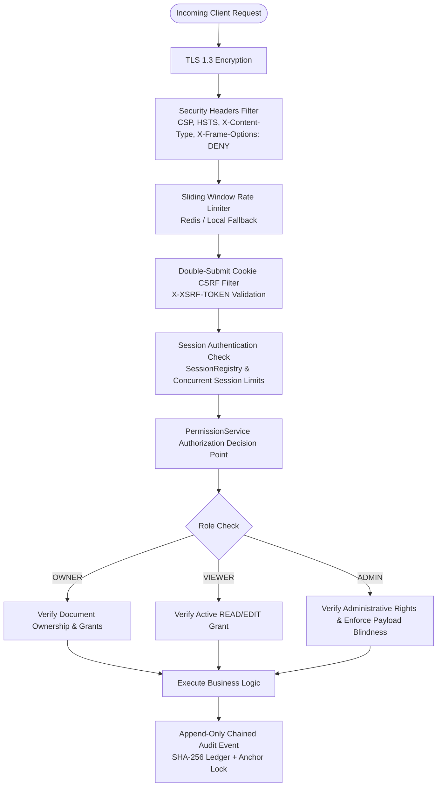
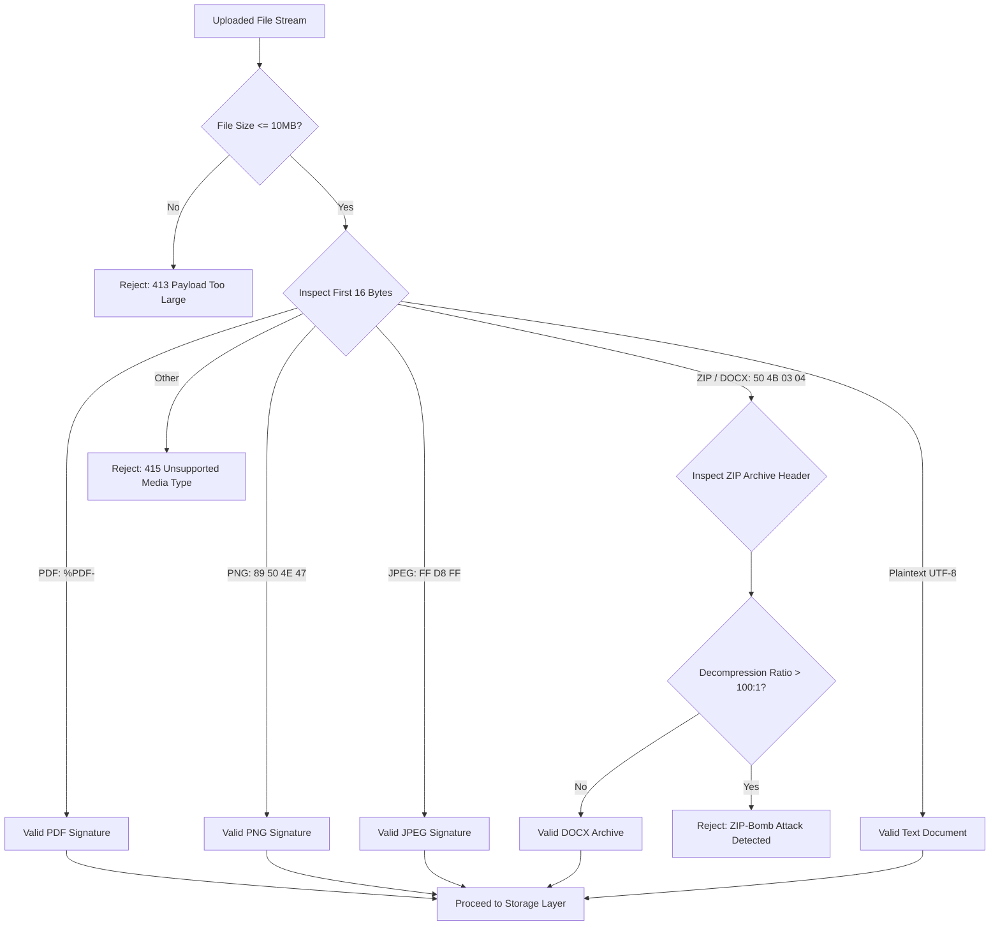

# TrustVault Enterprise Security & Cryptographic Architecture

## 1. Zero-Trust Security Architecture

TrustVault operates under a strict **Zero-Trust Architecture (ZTA)** framework: *Never trust, always verify*. Every request hitting the backend is subjected to real-time authentication, authorization, cryptographic integrity verification, and rate limiting.



---

## 2. Separation of Duties: Cryptographic Payload Blindness

In traditional document management systems, administrators frequently hold superuser database and file read privileges, exposing sensitive corporate documents to internal insider threats or compromised admin credentials.

TrustVault mathematically and architecturally prevents this through **Strict Separation of Duties**:
- **Administrative Privileges**: An Administrator can inspect system health, manage user roles, audit historical actions, and apply sharing restrictions.
- **Payload Blindness**: The `DocumentDownloadService` and `PermissionService.requireRead()` explicitly deny read access to accounts with role `ADMIN`:
```java
// PermissionService.java - Enforces that Admins cannot download document bytes
public Document requireRead(Long documentId, User actor) {
    Document document = load(documentId);
    if (!hasAccess(document, actor.getId(), false)) {
        deny(actor, document, "VIEW", "Attempted to read a document without a READ grant");
    }
    return document;
}

// hasAccess() only returns true for Document Owner or explicit READ/EDIT grantees.
// Admin role does NOT bypass this check.
```
Any attempt by an Administrator to trigger `GET /api/documents/{id}/download` triggers a `403 Forbidden` response and commits an `ACCESS_REFUSED` security alert to the audit ledger.

---

## 3. Centralized Authorization Decision Point

Authorization logic is notoriously vulnerable when scattered across multiple controllers. TrustVault centralizes all access evaluation in `PermissionService.java`:

| Method | Enforced Policy |
| :--- | :--- |
| `requireRead(documentId, actor)` | Verifies actor is Document Owner or possesses an active `READ` or `EDIT` grant. |
| `requireEdit(documentId, actor)` | Verifies actor is Document Owner or possesses an active `EDIT` grant. |
| `requireOwner(documentId, actor)` | Verifies actor is the original uploading owner of the document. |
| `requireOwnerOrAdmin(documentId, actor)` | Permitted exclusively for access grant management and restriction adjustment. |

Because services handling file binaries require a valid `Document` entity returned by these methods, bypassing authorization is architecturally impossible.

---

## 4. Cryptographic Document & Audit Integrity

### 4.1 Content-Addressable SHA-256 Document Hashing
When a document is uploaded:
1. The raw input stream is streamed through a `MessageDigest` instance calculating its SHA-256 hash in real time.
2. The 64-character hexadecimal digest is recorded in `documents.content_hash`.
3. Before any download stream is flushed to the network, the file bytes are re-hashed and compared against the recorded hash.
4. If storage corruption or unauthorized modification occurs on disk, the system halts with an integrity error and alerts administrators.

### 4.2 Append-Only Tamper-Evident Audit Ledger
The audit ledger connects every event into an unbroken cryptographic chain:
- **Genesis Block**: Seeded during Flyway `V1` with `head_hash = 'GENESIS'`.
- **Row-Lock Concurrency**: Every log write begins by acquiring a `SELECT ... FOR UPDATE` lock on `audit_chain_anchor` row `1`.
- **Chain Formulation**:
  $$H_i = \text{SHA-256}(H_{i-1} \parallel \text{ActorEmail} \parallel \text{Action} \parallel \text{Outcome} \parallel \text{DocID} \parallel T_i \parallel \text{Details})$$
- **Tamper Evidence**: If an adversary modifies or deletes a historical row in the database, the recalculated hash chain will diverge from the head anchor, pinpointing the exact modified record ID during automated verification.

---

## 5. Storage Security & Path Traversal Immunity

TrustVault eliminates path traversal vulnerabilities (`../../etc/shadow`) through three layers of defense:
1. **Opaque UUID v4 Keys**: Files are assigned a random UUID at upload time (e.g. `e0a35db4-4b52-475a-bc81-8d234ce5a432`).
2. **Key Validation Regex**: Prior to filesystem or bucket access, storage keys are strictly validated against:
   `^[0-9a-fA-F]{8}-[0-9a-fA-F]{4}-[0-9a-fA-F]{4}-[0-9a-fA-F]{4}-[0-9a-fA-F]{12}$`
3. **Decoupled User Filenames**: The user-facing filename (`fileName`) is stored strictly in the database for display purposes and never touches the filesystem API.

---

## 6. Deep File Content Validation

TrustVault does not rely on client-supplied file extensions or MIME headers. All uploads are scanned by `FileValidationService`:



- **Magic Byte Validation**: Verifies native hexadecimal file signatures. A `.exe` renamed to `.pdf` is immediately blocked.
- **Decompression-Bomb (ZIP-Bomb) Defense**: For DOCX archives, the validation service inspects compression ratios and limits maximum uncompressed entries.
- **XML External Entity (XXE) Defense**: Document parsers disable inline DTDs and external entities, preventing SSRF and file disclosure attacks.

---

## 7. Transport & Session Security

- **Content Security Policy (CSP)**:
  `default-src 'self'; script-src 'self'; style-src 'self' fonts.googleapis.com; font-src fonts.gstatic.com; img-src 'self' data:; connect-src 'self'; frame-ancestors 'none';`
- **Frame Busting**: `X-Frame-Options: DENY` blocks clickjacking.
- **Session Fixation Defense**: Migrates session IDs upon authentication (`sessionFixation().migrateSession()`).
- **Concurrent Session Control**: Limits users to a single active session (`maximumSessions(1)`).
- **Double-Submit CSRF Protection**: Spring Security's `CookieCsrfTokenRepository` issues an `XSRF-TOKEN` cookie validated against the `X-XSRF-TOKEN` header on every state-mutating request.
- **Rate Limiting**: Integrated sliding-window token bucket filter (Redis-backed in multi-node setups with an automatic in-memory fallback) protects login and password reset routes against brute-force attacks.
