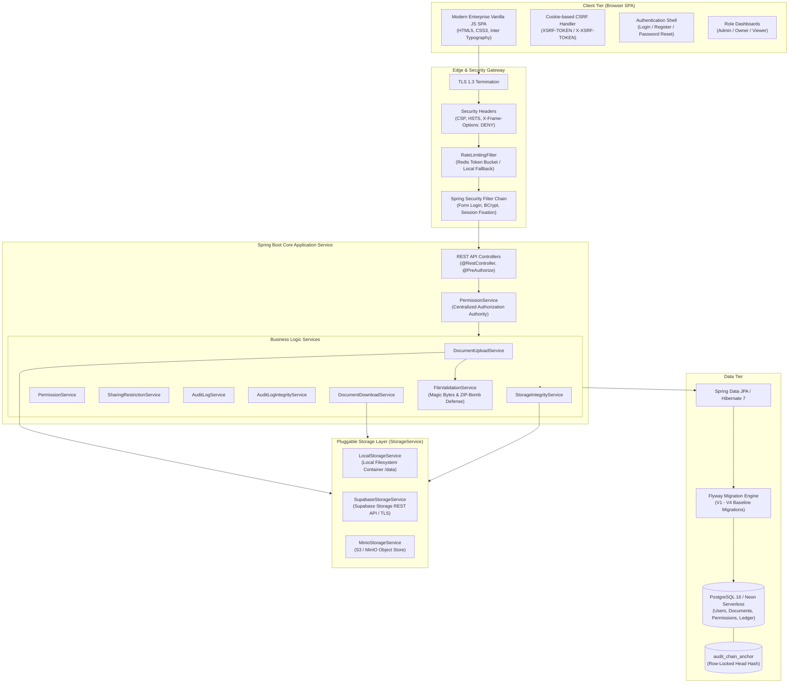
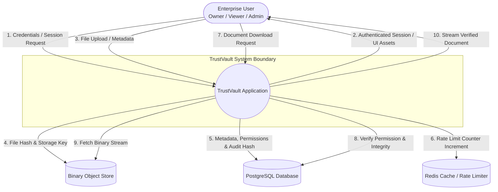
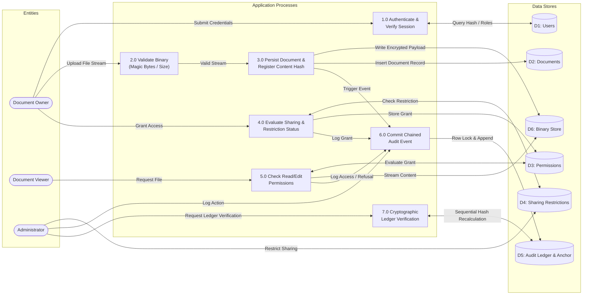
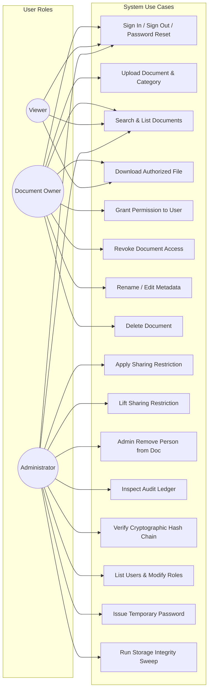
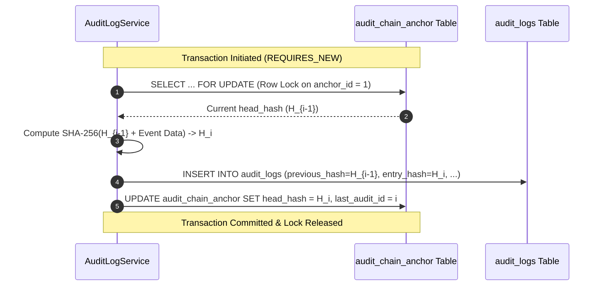
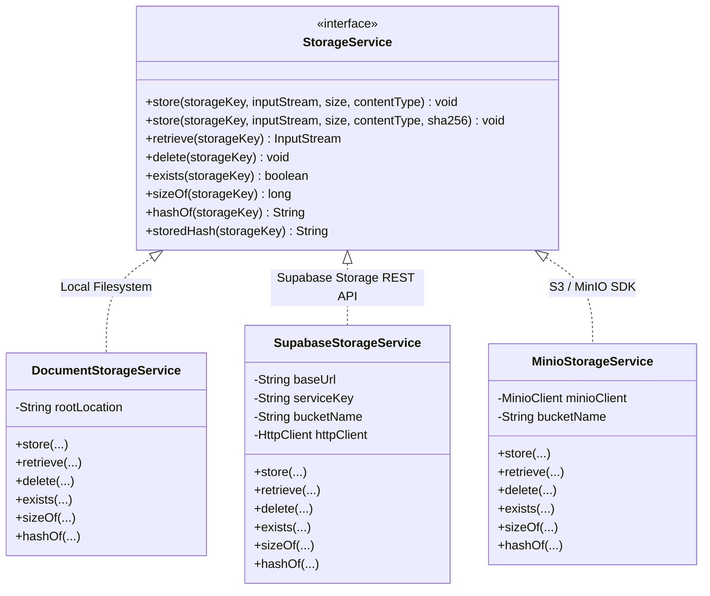

# TrustVault System Architecture Documentation

## 1. Architectural Overview

TrustVault is architected as an **Enterprise Zero-Trust Document Management and Cryptographic Audit System**. It enforces strict separation of duties, defense-in-depth security, and provable immutability across multi-tier enterprise deployments.

The system is designed around four foundational architectural principles:

1. **Centralized Decision Enforcement (Single Point of Authorization)**:
   Every inbound read, write, update, share, or download request is funneled through a centralized authorization gateway (`PermissionService`). Controllers contain zero standalone permission logic, preventing authorization bypasses and logic drift.
2. **Cryptographic Blindness (Separation of Duties)**:
   System Administrators possess broad administrative oversight over user accounts, role allocations, sharing restrictions, and audit ledgers, but are **cryptographically and architecturally barred** from accessing, opening, or downloading raw document payloads.
3. **Provable Ledger Immutability (Chained Merkle-Style Ledger)**:
   All security-critical actions are committed into an append-only audit trail anchored by an immutable SHA-256 hash chain. Any retrofitted tampering or deletion breaks the hash sequence and is instantly detected by automated verification algorithms.
4. **Decoupled Binary Storage Layer**:
   Document metadata, access matrices, and file binaries are decoupled. The database stores metadata and SHA-256 content hashes, while raw binaries are stored in an abstract storage provider (`StorageService`) using randomized UUID v4 storage keys, eliminating directory traversal vulnerabilities.

---

## 2. High-Level Component Architecture

---

## 3. Data Flow Diagrams (DFD)

### 3.1 Level 0 Context Diagram

### 3.2 Level 1 Detailed Data Flow Diagram

---

## 4. Use Case Analysis by Actor Role

---

## 5. Cryptographic Ledger & Audit Chain Architecture

TrustVault implements a tamper-evident audit ledger using sequential SHA-256 hash chaining anchored by a database row lock on `audit_chain_anchor`.

### 5.1 Ledger Structure

Each log entry $E_i$ incorporates:
1. Prior Hash: $H_{i-1}$ (retrieved from entry $E_{i-1}$, or `"GENESIS"` if $i=1$).
2. Event Attributes: Actor ID, Actor Email, Action, Outcome, Document ID, Document Name, Target User, Details, Timestamp ($T_i$).
3. Content Hash: Computed as:
   $$\text{EntryHash}_i = \text{SHA-256}(H_{i-1} \parallel \text{Actor} \parallel \text{Action} \parallel \text{Outcome} \parallel \text{DocID} \parallel T_i \parallel \text{Details})$$

### 5.2 Chain Verification Algorithm

When an Administrator clicks **Verify Chain**:
1. `AuditLogIntegrityService` loads all audit records ordered by ID ascending.
2. It initializes an expected hash variable to `"GENESIS"`.
3. For every record:
   - Verifies that `record.previousHash == expectedHash`.
   - Recomputes the SHA-256 digest of the record's payload combined with `record.previousHash`.
   - Compares the recomputed hash with `record.entryHash`.
   - Sets `expectedHash = record.entryHash`.
4. Finally, verifies that the final `expectedHash` matches `head_hash` in `audit_chain_anchor`.
5. If any record has been modified, deleted, or inserted out of band, verification halts and reports the exact broken record ID.

---

## 6. Storage Subsystem Abstraction

To ensure portability across on-premise servers, cloud VMs, and cloud-native object stores, physical file handling is isolated behind the `StorageService` interface.

- **UUID Storage Keys**: Storage keys are generated as random UUIDs (e.g., `4fa9c90b-689b-4395-827c-3f9b2d88a102`). The user-provided filename is never used to construct paths on disk or in the bucket, entirely preventing path traversal attacks (`../../etc/passwd`).
- **Integrity Validation on Read**: On download, the stored file's byte stream is verified against the cryptographic `content_hash` recorded at upload time before returning the payload to the user.
