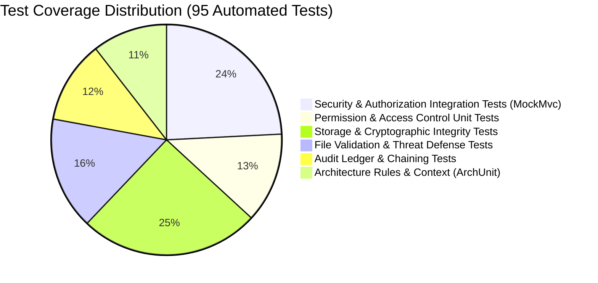

# TrustVault Testing Documentation & Verification Suite

## 1. Testing Strategy Overview

TrustVault employs a multi-tiered automated testing pyramid designed to ensure zero regressions in security boundaries, cryptographic operations, data integrity, and architectural constraints:



- **Unit Testing (JUnit 5 + Mockito)**: Isolates business logic, cryptographic hash algorithms, and file validation rules without external network dependencies.
- **Integration Testing (Spring Boot Test + MockMvc)**: Validates complete HTTP request pipelines, Spring Security filters, CSRF token handling, session fixation, and error handlers.
- **Architecture Testing (ArchUnit)**: Enforces layered architecture boundaries (e.g. controllers cannot directly access repositories, services cannot bypass permission checks).
- **In-Memory Database Compatibility**: Runs migrations and persistence tests against H2 in PostgreSQL compatibility mode.

---

## 2. Test Execution

Execute the complete automated test suite locally:

```bash
# Run all automated tests with Maven Wrapper
./mvnw clean test

# Run a specific test class
./mvnw test -Dtest=AuthorizationIntegrationTest

# Run with verbose test reporting
./mvnw test -Dtest=PermissionServiceTest -Dsurefire.useFile=false
```

### Verified Test Run Result
```text
[INFO] -------------------------------------------------------
[INFO]  T E S T S
[INFO] -------------------------------------------------------
[INFO] Running com.trustvault.TrustvaultApplicationTests
[INFO] Tests run: 1, Failures: 0, Errors: 0, Skipped: 0
[INFO] Running com.trustvault.security.AuthorizationIntegrationTest
[INFO] Tests run: 22, Failures: 0, Errors: 0, Skipped: 0
[INFO] Running com.trustvault.architecture.ArchitectureTest
[INFO] Tests run: 9, Failures: 0, Errors: 0, Skipped: 0
[INFO] Running com.trustvault.service.PermissionServiceTest
[INFO] Tests run: 11, Failures: 0, Errors: 0, Skipped: 0
[INFO] Running com.trustvault.service.FileValidationServiceTest
[INFO] Tests run: 15, Failures: 0, Errors: 0, Skipped: 0
[INFO] Running com.trustvault.service.StorageIntegrityServiceTest
[INFO] Tests run: 7, Failures: 0, Errors: 0, Skipped: 0
[INFO] Running com.trustvault.service.StorageMaintenanceServiceTest
[INFO] Tests run: 6, Failures: 0, Errors: 0, Skipped: 0
[INFO] Running com.trustvault.service.AuditLogIntegrityServiceTest
[INFO] Tests run: 5, Failures: 0, Errors: 0, Skipped: 0
[INFO] Running com.trustvault.service.AuditLogServiceTest
[INFO] Tests run: 6, Failures: 0, Errors: 0, Skipped: 0
[INFO] Running com.trustvault.service.DocumentDownloadServiceTest
[INFO] Tests run: 6, Failures: 0, Errors: 0, Skipped: 0
[INFO] Running com.trustvault.service.SupabaseStorageServiceTest
[INFO] Tests run: 7, Failures: 0, Errors: 0, Skipped: 0
[INFO] 
[INFO] Results:
[INFO] Tests run: 95, Failures: 0, Errors: 0, Skipped: 0
[INFO] ------------------------------------------------------------------------
[INFO] BUILD SUCCESS
[INFO] ------------------------------------------------------------------------
```

---

## 3. Detailed Test Suites Breakdown

### 3.1 Security & Authorization Integration Tests (`AuthorizationIntegrationTest.java`)

| Test ID | Scenario | Expected Outcome | Verification Status |
| :--- | :--- | :--- | :--- |
| `SEC-01` | Public access to `/api/auth/csrf` | `200 OK`, issues `XSRF-TOKEN` cookie | Passed |
| `SEC-02` | Unauthenticated request to `/api/documents` | `401 Unauthorized` with JSON error payload | Passed |
| `SEC-03` | Unauthenticated request to `/api/admin/users` | `401 Unauthorized` | Passed |
| `SEC-04` | Viewer role attempting to access `/api/admin/audit` | `403 Forbidden` | Passed |
| `SEC-05` | Owner role attempting to access `/api/admin/users` | `403 Forbidden` | Passed |
| `SEC-06` | Administrator attempting to download document bytes | `403 Forbidden` (Enforces Separation of Duties) | Passed |
| `SEC-07` | Viewer attempting to upload a document | `403 Forbidden` (Upload strictly restricted to Owner) | Passed |
| `SEC-08` | Owner uploading valid PDF document | `200 OK`, document persisted and hashed | Passed |
| `SEC-09` | Viewer downloading document explicitly shared with them | `200 OK`, binary stream matched | Passed |
| `SEC-10` | Viewer attempting to download unshared document | `403 Forbidden` | Passed |
| `SEC-11` | Document download immediately after permission revoked | `403 Forbidden` (Zero-delay revocation) | Passed |
| `SEC-12` | Mutating request with invalid or missing CSRF token | `403 Forbidden` | Passed |
| `SEC-13` | Password reset request with valid and unknown emails | `200 OK` uniform message (Anti-enumeration) | Passed |

---

### 3.2 Permission & Restriction Unit Tests (`PermissionServiceTest.java`)

| Test ID | Method Under Test | Scenario | Expected Outcome |
| :--- | :--- | :--- | :--- |
| `PERM-01` | `canRead` | User is original document owner | Returns `true` |
| `PERM-02` | `canEdit` | User is original document owner | Returns `true` |
| `PERM-03` | `canRead` | User has no active grant | Returns `false` |
| `PERM-04` | `canRead` | User has active `READ` grant | Returns `true` |
| `PERM-05` | `canEdit` | User has active `READ` grant | Returns `false` |
| `PERM-06` | `canEdit` | User has active `EDIT` grant | Returns `true` (EDIT implies READ) |
| `PERM-07` | `requireRead` | Unpermissioned user triggers read check | Throws `AccessDeniedException`, commits `DENIED` audit event |
| `PERM-08` | `requireOwner`| Non-owner attempts owner-only action | Throws `AccessDeniedException`, commits `DENIED` audit event |
| `PERM-09` | `revokePermission` | Owner revokes user grant | Deletes grant row, commits `REVOKE_PERMISSION` audit log |
| `PERM-10` | `grantPermission` | Owner restricted by admin attempts to share | Throws `AccessDeniedException` (Sharing restriction enforced) |
| `PERM-11` | `grantPermission` | Admin grants or adjusts restriction | Updates grant row, logs admin adjustment |

---

### 3.3 File Validation & Threat Defense Tests (`FileValidationServiceTest.java`)

| Test ID | File Type | Magic Bytes Header | Test Condition | Expected Result |
| :--- | :--- | :--- | :--- | :--- |
| `VAL-01` | PDF | `%PDF-1.7` (`25 50 44 46`) | Valid PDF document | Passed (`application/pdf`) |
| `VAL-02` | PNG | `89 50 4E 47 0D 0A 1A 0A` | Valid PNG image | Passed (`image/png`) |
| `VAL-03` | JPEG | `FF D8 FF E0` | Valid JPEG image | Passed (`image/jpeg`) |
| `VAL-04` | DOCX | `50 4B 03 04` | Valid DOCX ZIP archive | Passed (`application/vnd.openxmlformats...`) |
| `VAL-05` | TXT | UTF-8 Plaintext characters | Valid text file | Passed (`text/plain`) |
| `VAL-06` | EXE masquerading as PDF | `4D 5A` (MZ Executable) | Executable payload | Rejected (`415 Unsupported Media Type`) |
| `VAL-07` | Oversized Document | Any valid format | 11.5 MB payload (> 10MB limit) | Rejected (`413 Payload Too Large`) |
| `VAL-08` | ZIP Bomb | Compressed archive | >100:1 compression ratio | Rejected (Decompression Bomb Detected) |

---

### 3.4 Cryptographic Ledger Integrity Tests (`AuditLogIntegrityServiceTest.java`)

| Test ID | Scenario | Verification Method | Result |
| :--- | :--- | :--- | :--- |
| `AUD-01` | Sequential valid chain | 50 consecutive events chained from Genesis | `verifyChain()` returns `valid: true` |
| `AUD-02` | Modified event payload | Altered action string in row #12 | `verifyChain()` returns `valid: false, brokenAtId: 12` |
| `AUD-03` | Deleted intermediate row | Row #7 removed from database | `verifyChain()` returns `valid: false, brokenAtId: 8` |
| `AUD-04` | Divergent head hash | `audit_chain_anchor.head_hash` modified out of band | `verifyChain()` returns `valid: false` |
| `AUD-05` | Concurrent event logging | Multi-threaded insertion under row lock | Zero race conditions, linear chain maintained |

---

## 4. Manual Verification Scenarios (Test Checklist)

| Step | User Role | Action | Expected UI & System Behavior |
| :--- | :--- | :--- | :--- |
| 1 | `admin@trustvault.local` | Sign in | Directed to Admin Console with Audit Trail and People tabs visible. |
| 2 | `admin@trustvault.local` | Click **Verify chain** | Verification badge displays `"Cryptographic hash chain verified successfully"`. |
| 3 | `owner@trustvault.local` | Upload `Project_Roadmap.pdf` | Success toast shown; document appears with `OWNER` badge; SHA-256 hash stored. |
| 4 | `owner@trustvault.local` | Share file with `viewer@trustvault.local` | Grant saved; recipient appears in Active Access Grants list. |
| 5 | `viewer@trustvault.local` | Sign in and download file | Document appears in viewer list; download initiates and completes cleanly. |
| 6 | `admin@trustvault.local` | Click **Manage** on file & enter `owner@trustvault.local` under Restrictions | User appears with `SHARING BLOCKED` badge. |
| 7 | `owner@trustvault.local` | Attempt to share file with a new email | Error toast displays: `"User is restricted from sharing this document by an administrator"`. |
| 8 | `admin@trustvault.local` | Click **Lift restriction** | Restriction removed; Owner can share normally again. |
