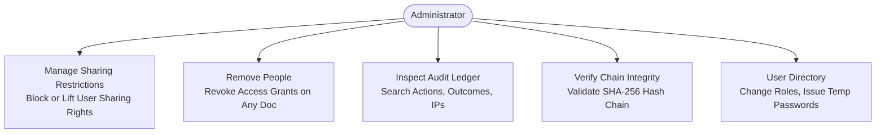
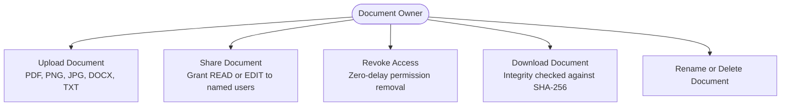
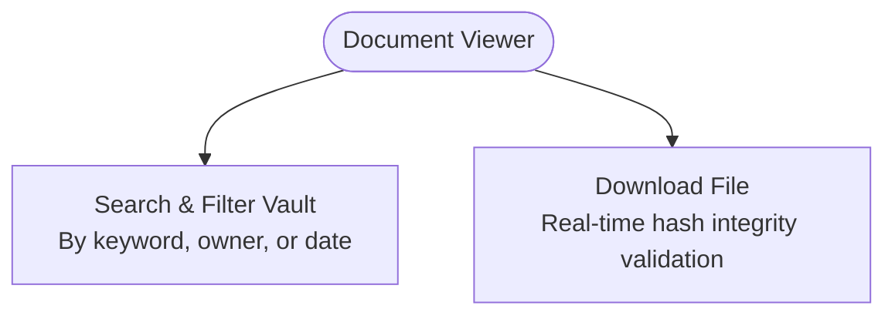

# TrustVault User Manual & Role Guide

## 1. System Access & Authentication

TrustVault is accessed through any modern desktop or mobile browser via standard HTTPS.

### 1.1 Signing In
1. Navigate to the TrustVault URL (e.g. `https://your-domain.com` or `http://localhost:8080`).
2. Ensure the **Sign In** tab is active.
3. Enter your registered work email address and password.
4. Click **Show** inside the password input if you wish to verify character entry.
5. Click **Sign In**. Upon successful verification, the system loads your role-specific dashboard.

### 1.2 Creating an Enterprise Account
1. On the authentication shell, select the **Create Account** tab.
2. Enter your **Full Legal Name**, **Work Email Address**, and a secure password (minimum 12 characters).
3. Click **Create Account**. Your account will be created with the default `OWNER` role, allowing you to upload and share confidential documents immediately.

### 1.3 Recovering Account Access (Password Reset)
1. On the sign-in form, click **Forgot password?**.
2. Enter your registered email address and click **Request Password Reset**.
3. In accordance with TrustVault's zero-trust policy, password reset links are not emailed to prevent link-forwarding or inbox-interception attacks. Instead, a System Administrator generates an ephemeral one-time temporary password for you via the Administrator Console.

---

## 2. Administrator Guide

The Administrator role (`ADMIN`) possesses comprehensive operational oversight over security ledgers, user accounts, and sharing policies while remaining cryptographically barred from accessing confidential document contents.

### 2.1 Applying a Document Sharing Restriction
Administrators can prevent a specific user (such as a document owner or collaborator) from sharing a sensitive document with third parties while preserving their direct ability to view or edit the file:

1. In the **Documents** tab, locate the target document in the table.
2. Click the **Manage** button in the Actions column.
3. The access management modal opens. Scroll down to the **Administrative Sharing Restrictions** section.
4. Enter the email address of the user you wish to restrict (e.g., `owner@company.com`).
5. Click **Restrict from Sharing**.
6. The user is immediately listed with a red `SHARING BLOCKED` status pill. Any future attempt by that user to share the document will be rejected with an access denial.

### 2.2 Lifting a Sharing Restriction
1. Open the document management modal via **Manage**.
2. Under **Active Sharing Restrictions**, locate the restricted user.
3. Click **Lift restriction**. The user's sharing rights on that file are instantly restored.

### 2.3 Removing a Person from Document Access
1. Open the document management modal via **Manage**.
2. Under **Active Access Grants**, locate the user you want to remove.
3. Click **Remove person**.
4. The user's grant row is deleted, and their access to the document is immediately terminated.

### 2.4 Verifying Audit Ledger Cryptographic Integrity
1. Click the **Audit Trail & Ledger** tab in the top navigation bar.
2. Click the primary **Verify Chain Integrity** button.
3. The system recalculates every SHA-256 hash from Genesis to Head.
4. A green badge indicates success: `Chain verified across N entries`. If any row in the database was modified out of band, a red warning highlights the exact compromised entry number.

### 2.5 User Role Management & Temporary Passwords
1. Click the **User Management** tab.
2. **Change Role**: Locate the user in the table, select their new role (`ADMIN`, `OWNER`, `VIEWER`) from the dropdown. The change is applied instantly and logged to the ledger. (Admins cannot change their own role to prevent lockout).
3. **Issue Temporary Password**: Click **Issue temp password** next to the user. A confirmation prompt warns that their current password will be invalidated immediately.
4. The generated password appears inside the blue credential vault box. Click **Copy Password** to transmit it securely to the user.

---

## 3. Document Owner Guide

The Owner role (`OWNER`) is the primary workspace role for creating, organizing, and collaborating on sensitive enterprise records.

### 3.1 Uploading a Document
1. Navigate to the **Documents** tab.
2. Locate the **Upload Confidential Document** card at the top.
3. Click **Choose File** and select your document (PDF, DOCX, PNG, JPG, or TXT up to 10 MB).
4. Enter a **Security Category** (e.g. `Finance`, `Legal`, `HR`, `Engineering`).
5. Click **Upload & Hash**.
6. The file is streamed, scanned for magic-byte integrity, assigned a UUID storage key, hashed with SHA-256, and appended to your documents table.

### 3.2 Sharing a Document
1. In the **Documents** table, click **Share** next to your document.
2. Under **Grant Document Access**, enter the recipient's exact work email address.
3. Select the desired access tier:
   - **READ**: Recipient can view and download the file.
   - **EDIT**: Recipient can view, download, and update metadata (filename and category).
4. Click **Grant Access**.
5. The grantee appears immediately under **Active Access Grants**.

### 3.3 Revoking Document Access
1. Open the share modal by clicking **Share**.
2. In the **Active Access Grants** list, locate the user whose access is ending.
3. Click **Revoke**.
4. The user is removed, and any subsequent download attempts by that user will be refused.

### 3.4 Downloading an Owned Document
1. In the **Documents** table, click the blue **Download** button.
2. The server verifies the file bytes against the upload SHA-256 content hash and streams the file to your browser.

### 3.5 Renaming or Deleting a Document
- **Rename**: Click **Rename**, enter the new filename and updated category, and confirm.
- **Delete**: Click **Delete**, review the warning prompt, and confirm. The database record and physical storage object are permanently purged.

---

## 4. Viewer Guide

The Viewer role (`VIEWER`) provides a streamlined, read-only portal for stakeholders, auditors, and clients who need to consume shared materials securely.

### 4.1 Viewing Accessible Documents
1. Log in with your Viewer account.
2. The **Documents Vault** table displays only documents that have been explicitly shared with you by an Owner or Administrator.
3. The **Your Access** column indicates whether your account has `READ` or `EDIT` permissions.

### 4.2 Filtering & Searching
1. In the **Filter & Search Vault** card:
   - Enter keywords into **Name or Category**.
   - Filter by **Owner Email** or specify an **Uploaded From / To** date range.
2. Click **Apply Filter**.
3. Click **Reset** to return to the full list of accessible documents.

### 4.3 Downloading Documents
1. Click **Download** next to any authorized file.
2. The download will start automatically once cryptographic integrity is confirmed.

---

## 5. Error Messages & Troubleshooting

| Error Message | Meaning | Recommended Resolution |
| :--- | :--- | :--- |
| `Invalid email or password` | Incorrect login credentials. | Check email spelling or ask an Admin to issue a temporary password. |
| `Request failed (403)` | Access denied by server policy. | You do not have permission for this action (e.g., Admin trying to download, Viewer trying to upload). |
| `User is restricted from sharing this document` | Administrative sharing restriction is active. | Contact your System Administrator to lift the sharing restriction on this document. |
| `File exceeds 10 MB limit` | Upload payload is too large. | Compress the document or split it before uploading. |
| `Unsupported media type` | File failed magic-byte inspection. | Ensure the file is a genuine PDF, PNG, JPG, DOCX, or TXT document (not an executable renamed to `.pdf`). |
| `Chain verification FAILED at #N` | Cryptographic ledger tampering detected. | Investigate database record #N for manual alteration or unauthorized deletion. |
